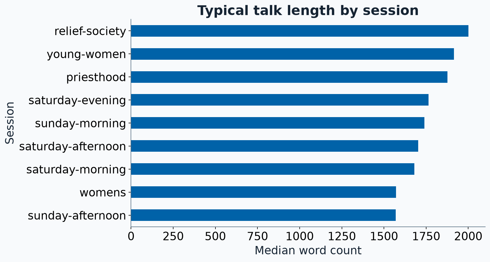
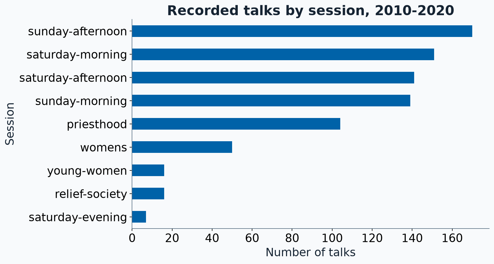
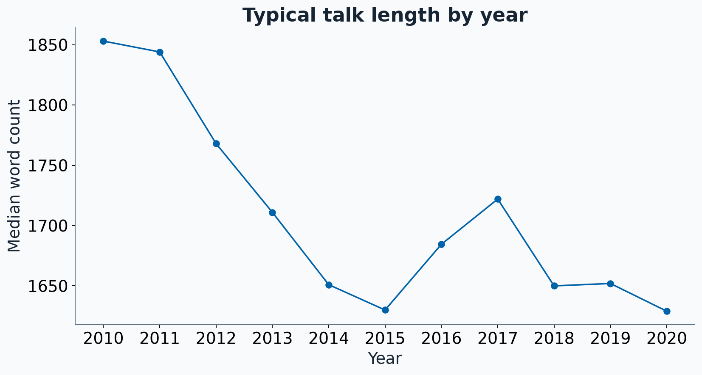
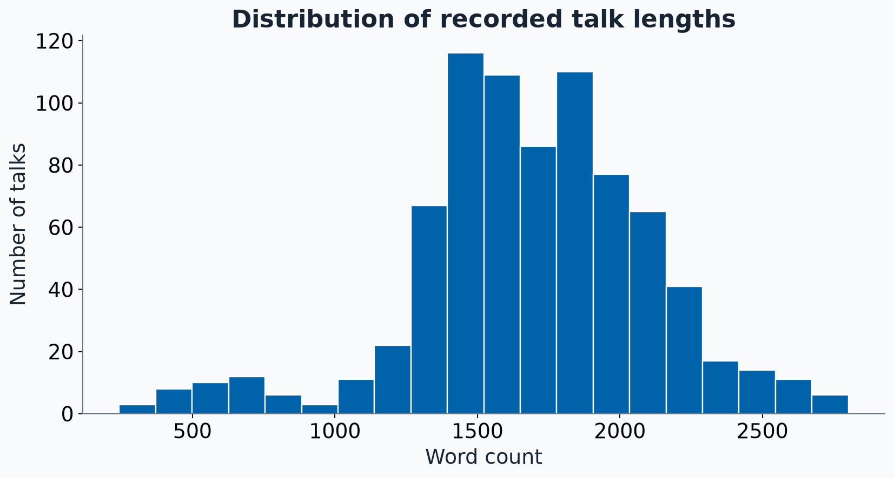
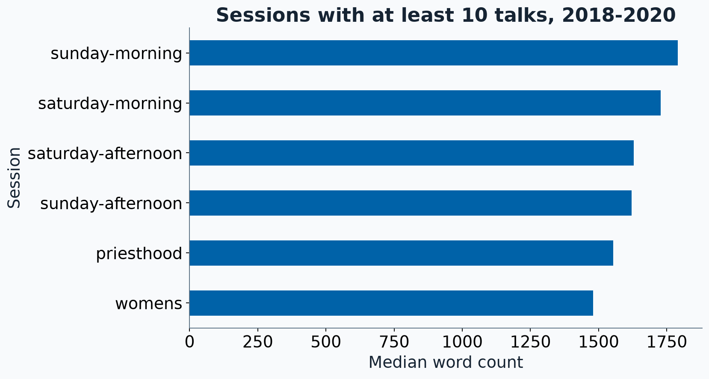

## Review: decode this pipeline

`talks` contains 794 rows. Each row represents one talk.

```python
answer = (
    talks.loc[
        (talks["year"] == 2020)
        & (talks["session"] == "sunday-morning"),
        ["talk_name", "speaker", "num_words"]
    ]
    .sort_values("num_words", ascending=False)
    .head(3)
)
```

With a partner: state the question this code answers.

What does one output row represent? What changes if `head(3)` comes first?

::: {.notes}
Allow 45 seconds individually and 60 seconds with a partner. Expected: three Sunday morning talks from 2020 with the largest word counts, showing title, speaker, and word count. Output rows still represent talks. Taking head first restricts the candidate rows before the comparison. Do not reveal the answer until pairs have a chance to respond.
:::

## Review: the decoded question

> Find the three Sunday morning talks from 2020 with the largest word counts.
> Show the title, speaker, and word count.

::: {.result-table}

:::

Filtering and column selection come before ordering and taking three rows.

::: {.notes}
Immediate review debrief. The computed result has shape (3, 3). Ask one pair to explain the two axes of loc and another to explain why sorting comes before head. Taking head first restricts the candidates before finding the largest counts. Allow about one minute.
:::

## Review: construct a pipeline

> Find the three Saturday morning talks from 2019 or 2020 with the largest word counts. Show the title, speaker, year, and word count.

Write the code with a partner. Use named steps or a method chain.

- Which observations qualify?
- Which columns belong in the result?
- What order should the operations follow?
- What is one useful result check?

::: {.notes}
Allow two minutes. Students can write in checkpoint 0 of the starter activity or on paper before opening the repository. Listen for between, isin, or a correctly parenthesized OR. All are acceptable. Reuse the foundations vocabulary without another full explanation of loc/iloc.
:::

## Review: one working solution

:::: {.columns}
::: {.column width="48%"}
```python
mask = (
    talks["year"].between(2019, 2020)
    & (talks["session"] == "saturday-morning")
)
answer = (
    talks.loc[mask,
              ["talk_name", "speaker", "year", "num_words"]]
    .sort_values("num_words", ascending=False)
    .head(3)
)
```
:::
::: {.column width="48%"}
::: {.result-table}

:::
:::
::::

Check that every row qualifies and word counts decrease.

::: {.notes}
Immediate construction debrief. The output contains three talks with the four requested columns. The largest values are across both allowed years, so sorting by year first would answer a different request. Named steps and method chains are both acceptable.
:::

## A question about groups

> How does typical talk length vary across session categories?

::: {.question}
What should one row of the answer represent?
:::

The question determines the **groups**, the **summary**, and the **comparison**.

We need a definition of typical and the number of observations in each group.

::: {.notes}
Collect a mean or median proposal and a result-unit proposal. Session categories recur across conferences, so one row represents a category, not a single conference session. This slide also supplies the roadmap: aggregation changes the result unit, transformation retains talk rows, and plotting displays the analysis. Keep framing to about two minutes.
:::

## A small teaching table

These six invented talks make the arithmetic easy to inspect.

:::: {.columns}
::: {.column width="48%"}
```python
toy = pd.DataFrame({
    "talk": list("ABCDEF"),
    "session": ["morning"] * 3
               + ["afternoon"] * 3,
    "num_words": [1000, 2000, 3000,
                  1000, 1200, 1400],
})
```
:::
::: {.column width="48%"}
::: {.result-table}

:::
:::
::::

::: {.notes}
Explain that these are invented teaching data. The code and computed table appear together so students can reason without opening an editor. The same six observations recur in the GroupBy, filtering-order, and transformation examples.
:::

## Prediction: a median for each session

Using the six-talk table, sketch the answer to:

> What is the median word count in each session?

- How many rows should the answer have?
- What should the columns contain?
- Does the answer still identify talk C?

::: {.notes}
First conceptual pause. Allow 45 seconds individually and 60 seconds with a partner. Expected: two rows, session and median_words. Morning median 2000, afternoon median 1200. Talk identities disappear during this aggregation. The next slide is the immediate debrief.
:::

## A summary changes what a row represents

```python
toy_summary = toy.groupby("session", as_index=False).agg(
    median_words=("num_words", "median")
)
```
::: {.result-table}

:::

::: {.takeaway}
Six talk rows become two session rows.
:::

::: {.notes}
Immediate prediction debrief. Group identity and medians remain, while individual talk identities disappear. as_index=False keeps the grouping variable in a regular column. The output comes from the teaching data generator.
:::

## Grouping: split, apply, combine

| Step | In this example |
|:--|:--|
| Split | Associate each talk row with its session |
| Apply | Calculate a median from each group’s values |
| Combine | Label each result with its session |

```python
toy.groupby("session")["num_words"].median()
```
::: {.result-table}

:::

::: {.notes}
Connect each step to the six-talk table. The displayed table presents the two labeled values returned by the Series. The term apply names the conceptual calculation step, not a requirement to call .apply(). Source: https://pandas.pydata.org/docs/user_guide/groupby.html
:::

## Inside a GroupBy object

:::: {.columns}
::: {.column width="48%"}
```python
grouped = toy.groupby("session")
print(type(grouped).__name__, grouped.ngroups)
grouped.indices
```

The object keeps the source data and the grouping instructions.

Group membership links a key to row positions.
:::
::: {.column width="48%"}


**afternoon:** positions 3, 4, 5

**morning:** positions 0, 1, 2
:::
::::

Grouping work happens when an inspection or calculation needs it.

::: {.notes}
Spend about two minutes on mechanics. Calling groupby validates the grouping specification and returns a GroupBy rather than a completed summary. pandas defers splitting work until it is needed. Accessing ngroups or indices requests grouping metadata and can trigger that work. indices maps group keys to positions, not index labels in the general case. Do not describe this as immediately copying each group into an independent DataFrame. Exact internal caches vary by pandas version. Source: https://pandas.pydata.org/docs/user_guide/groupby.html and https://pandas.pydata.org/docs/reference/api/pandas.api.typing.DataFrameGroupBy.indices.html
:::

## Inspecting and using a GroupBy

:::: {.columns}
::: {.column width="48%"}
```python
grouped.get_group("morning")
```
:::
::: {.column width="48%"}
::: {.result-table}

:::
:::
::::

:::: {.columns}
::: {.column width="48%"}
```python
grouped["num_words"].median()
grouped["num_words"].mean()
grouped.size()
```
:::
::: {.column width="48%"}
::: {.result-table}

:::
:::
::::

`grouped.obj is toy` returns `True`. The original table still has six rows.

::: {.notes}
Extracting a group makes its membership visible. The lower table places the three separately returned Series side by side to compare their results. Selecting num_words chooses values to work with; the reduction computes one answer per group. Built-in reductions use the group memberships and underlying values without requiring an explicit Python loop over rows. These inspection methods are for intuition, not a requirement to iterate through groups. get_group does not remove rows from the source table. Source: https://pandas.pydata.org/docs/reference/api/pandas.api.typing.DataFrameGroupBy.get_group.html
:::

## Overall and grouped summaries

:::: {.columns}
::: {.column width="48%"}
```python
talks["num_words"].median()
```

One median across all recorded talks.


:::
::: {.column width="48%"}
```python
talks.groupby("session")["num_words"].median()
```

One median for each session category.

::: {.result-table}

:::
:::
::::

::: {.question}
What reference group does each answer use?
:::

::: {.notes}
Preserve the original overall-versus-grouped example and the reference-group question. Students already know an overall reduction. A talk may exceed the overall median while falling below its own session median. The group table displays all nine labeled median values.
:::

## Counts and proportions

:::: {.columns}
::: {.column width="48%"}
```python
talks["session"].value_counts()

talks["session"].value_counts(
    normalize=True
)
```

Count talks, then divide by the number of nonmissing session labels.
:::
::: {.column width="48%"}
::: {.result-table}

:::
:::
::::

Here every session label is present, so the denominator is **794 talks**.

::: {.notes}
The output table places the separately returned count and proportion Series together, with proportions rounded to three decimals for display. The fractions describe talks, not unique speakers. Counts sum to 794; the displayed rounded proportions need not sum to exactly one. Source: https://pandas.pydata.org/docs/reference/api/pandas.Series.value_counts.html
:::

## A filter changes the denominator

:::: {.columns}
::: {.column width="48%"}
```python
recent = talks.loc[
    talks["year"].between(2018, 2020)
].copy()

recent["session"].value_counts(
    normalize=True
)
```

The reference contains **201 recent talks**.
:::
::: {.column width="48%"}
::: {.result-table}

:::
:::
::::

::: {.question}
If we filter to Sunday morning before counting, what proportion belongs to Sunday morning?
:::

::: {.notes}
Keep the denominator question as a quick verbal interaction. Expected one, because every remaining talk is Sunday morning. The output displays all seven recent categories. Fractions round to three decimals. Filtering changes the observations that contribute to a calculation.
:::

## Counting rows and recorded values

:::: {.columns}
::: {.column width="48%"}
```python
talks.groupby("session").size()

talks.groupby("session")["runtime"].count()
```

`size()` counts talk rows.

`count()` counts recorded values.
:::
::: {.column width="48%"}
::: {.result-table}

:::
:::
::::

Across the whole table: **794 talks, 663 recorded runtimes**.

::: {.notes}
The two returned Series appear side by side in the output table. There are 131 missing runtimes. No runtime parsing or repair is required. Count rows with size when the request asks how many observations there are. Session keys are complete; missing group keys would be excluded by default. Source: https://pandas.pydata.org/docs/user_guide/groupby.html
:::

## Several summaries in one table

```python
session_summary = (
    talks.groupby("session", as_index=False)
    .agg(
        n_talks=("num_words", "size"),
        mean_words=("num_words", "mean"),
        median_words=("num_words", "median"),
    )
    .sort_values("median_words", ascending=False)
)
```

Each named output specifies **an input column and a summary operation**.

::: {.result-table}

:::

`as_index=False` keeps `session` as a column. The next slide displays all nine rows.

::: {.notes}
Read one named aggregation aloud: create median_words by taking the median of num_words. size counts rows even if the selected value is missing. as_index=False keeps session as an ordinary column. The output names belong to the analyst, not the source data. Source: https://pandas.pydata.org/docs/user_guide/groupby.html#named-aggregation
:::

## Session summaries in the talks data

::: {.result-table}

:::

Counts describe how much data each median uses. Total words also depend on how many talks a category contains.

::: {.question}
Would ranking total words answer the same question as ranking median words?
:::

::: {.notes}
This generated table replaces the manually typed results. Means display one decimal place. Ask whether ranking totals would answer the same question as ranking median length. It would not. Groups differ in number of observations, historical coverage, and speakers. This incorporates the earlier separate group-size discussion without removing its question.
:::

## More than one grouping variable

:::: {.columns}
::: {.column width="48%"}
```python
year_session = (
    talks.groupby(
        ["year", "session"], as_index=False
    )
    .agg(n_talks=("num_words", "size"),
         median_words=("num_words", "median"))
)
year_session.head(4)
```
:::
::: {.column width="48%"}
::: {.result-table}

:::

Full result shape:


:::
::::

One row represents an **observed year-session combination**. Does every possible combination have to appear?

::: {.notes}
Keep the two-key example and its prediction. The display is explicitly the first four rows, not the whole result. With ordinary text keys, groups arise from observed combinations. No rectangular grid is guaranteed. Avoid pivots or MultiIndex machinery today.
:::

## Prediction: filtering order

Using the six invented talks, compare:

**A.** Keep talks with at least 1,500 words, then calculate session medians.

**B.** Calculate session medians from all six talks, then keep sessions whose median is at least 1,500 words.

::: {.question}
What morning median does each analysis report? Which talks contribute?
:::

::: {.notes}
Second conceptual pause. Give pairs 90 seconds. A uses only morning B and C, median 2500. B uses morning A, B, and C, median 2000. Afternoon disappears in both results for different reasons. Immediate answer follows.
:::

## The filter changes the question

:::: {.columns}
::: {.column width="48%"}
**A. Filter talk rows first**

```python
long_toy = toy.loc[toy["num_words"] >= 1500]
long_toy.groupby("session", as_index=False).agg(
    median_words=("num_words", "median")
)
```
::: {.result-table}

:::
:::
::: {.column width="48%"}
**B. Summarize first**

```python
toy_summary.loc[
    toy_summary["median_words"] >= 1500
]
```
::: {.result-table}

:::
:::
::::

A uses talks B and C. B uses talks A, B, and C to calculate its median.

::: {.notes}
Immediate debrief after the pair prediction. Both analyses keep only morning, but report 2500 and 2000 because the reference observations differ. Filtering observations changes the statistic. Filtering the summary selects groups. Both can be valid for their own question.
:::

## Prediction: a group reference for every row

> Which talks are longer than the median talk in their own session?

Fill in the reference beside each talk before writing code.

| talk | session | num_words | session_median_words |
|:--|:--|--:|:--:|
| A | morning | 1000 | ? |
| B | morning | 2000 | ? |
| C | morning | 3000 | ? |
| D | afternoon | 1000 | ? |
| E | afternoon | 1200 | ? |
| F | afternoon | 1400 | ? |

::: {.notes}
Allow 45 seconds, then ask a pair to explain the repeated values. The median for the row's session should appear beside each row. Return immediately with the filled table.
:::

## Transformation preserves talk rows

```python
toy["session_median_words"] = (
    toy.groupby("session")["num_words"].transform("median")
)
```
::: {.result-table}

:::

::: {.notes}
Immediate answer after the six-row prediction. Six values retain the original talk-row index. Group medians repeat beside their members. Ask which talks exceed the reference: C and F. Source: https://pandas.pydata.org/docs/user_guide/groupby.html#transformation
:::

## Aggregation and transformation

| Question | Operation | Result unit |
|:--|:--|:--|
| What is each session’s median? | `.agg()` or `.median()` | One row per session |
| What is this talk’s session median? | `.transform("median")` | One value per talk |

For the real dataset:

- Aggregation: 794 talk rows become 9 session rows.
- Transformation: 794 talk rows receive 794 aligned reference values.

::: {.notes}
A short summary of the conceptual distinction. The next code block should now feel motivated. Do not define transform merely as another method to memorize. Source: https://pandas.pydata.org/docs/user_guide/groupby.html
:::

## A comparison within each session

:::: {.columns}
::: {.column width="48%"}
```python
talks["session_median_words"] = (
    talks.groupby("session")["num_words"]
    .transform("median")
)
talks["above_session_median"] = (
    talks["num_words"]
    > talks["session_median_words"]
)
above = talks.loc[
    talks["above_session_median"]
]
```
:::
::: {.column width="48%"}
::: {.result-table}

:::

Four example rows from the transformed table.


Talks qualify across all recorded years.
:::
::::

::: {.notes}
The four displayed rows are a labeled example excerpt, chosen to include True and False outcomes. They correspond to original positions 0, 2, 10, and 12. The final filtering uses the familiar Boolean mask. Strict greater-than excludes ties, so exactly half need not qualify. Every reference here uses the full time window.
:::

## Labels explain why transform helps

```python
medians = talks.groupby("session")["num_words"].median()
reference = talks.groupby("session")["num_words"].transform("median")
```


`medians` has **session labels**. `reference` has **talk-row labels**.

Column assignment aligns index labels. Transformation provides the labels needed for the talk table.

::: {.notes}
Relate this to the Ana/Bo bonus alignment example in foundations. The printed first two labels make the mismatch visible. Directly assigning the group-indexed Series would align session strings with integer row labels and introduce missing values here. Do not require a join for this task.
:::

## The reference group includes the time window

:::: {.columns}
::: {.column width="48%"}
```python
recent = talks.loc[
    talks["year"].between(2018, 2020)
].copy()
recent["session_median_words"] = (
    recent.groupby("session")["num_words"]
    .transform("median")
)
```
:::
::: {.column width="48%"}
::: {.result-table}

:::

First three recent talk rows.
:::
::::

::: {.question}
How would the comparison change if we calculated the reference before filtering years?
:::

::: {.notes}
Keep the reference-window interaction. The reference values use only 2018-2020 observations. Before filtering years, the reference would use all recorded years. The final task requires the recent reference. The displayed table is an excerpt of a 201-row transformed result.
:::

## Dates provide time variables

The CSV stores dates as text, such as `2020-10-03 00:00:00.000`.

```python
talks["date"] = pd.to_datetime(
    talks["date"], format="%Y-%m-%d %H:%M:%S.%f"
)
talks["talk_year"] = talks["date"].dt.year
talks["talk_month"] = talks["date"].dt.month
```
::: {.result-table}

:::

First three rows. `.dt` extracts components from the datetime Series.

::: {.notes}
The displayed dates omit midnight times for readability but the underlying converted values are datetimes. Date format tokens represent year, month, day, hour, minute, second, and fractional second. Derived years match the provided year column. Do not invent conference dates or add coercion by default. Source: https://pandas.pydata.org/docs/reference/api/pandas.to_datetime.html
:::

## A yearly summary

:::: {.columns}
::: {.column width="48%"}
```python
annual = (
    talks.groupby("talk_year", as_index=False)
    .agg(n_talks=("num_words", "size"),
         median_words=("num_words", "median"))
    .sort_values("talk_year")
)
```

One row represents one year of recorded talks.
:::
::: {.column width="48%"}
::: {.result-table}

:::
:::
::::

::: {.notes}
Show all eleven years. Chronological order uses the numeric year rather than alphabetic conference text. Each point in the later line plot comes from one row here. Membership of the collection can differ across years. No resampling or time-series index is needed.
:::

## A bar chart of group medians

:::: {.columns}
::: {.column width="48%"}
```python
import matplotlib.pyplot as plt

ordered = session_summary.sort_values(
    "median_words"
)
ax = ordered.plot.barh(
    x="session", y="median_words",
    legend=False, figsize=(10, 5.5)
)
ax.set_xlabel("Median word count")
ax.set_ylabel("Session")
ax.set_title("Typical talk length by session")
plt.tight_layout()
plt.show()
```
:::
::: {.column width="48%"}
::: {.plot-image}
{height=510 fig-alt="Median word counts by session category."}
:::
:::
::::

`.plot.barh()` returns a Matplotlib Axes. Ascending order places the largest horizontal bar at the top.

::: {.notes}
This single code-and-figure slide combines the earlier plotting introduction, output slide, and formatting slide. The plotted values are generated from the same summary table. Matplotlib must be installed. The script sets cosmetic fonts and colors for presentation, while the shown commands supply the data, order, labels, and title. One bar represents one category. Preserve the question about what the bar represents. Source: https://pandas.pydata.org/docs/user_guide/visualization.html
:::

## A bar chart can display counts

```python
talks["session"].value_counts().sort_values().plot.barh()
plt.show()
```

::: {.plot-image}
{height=440 fig-alt="Horizontal bars showing the number of recorded talks in each session category."}
:::

::: {.notes}
This is a Series plot, so its index supplies category labels. Ask why the ranking differs from the median chart. A count measures frequency, a median measures typical length. The plotted version in the script adds axis labels, a title, and a larger figure size. Source: https://pandas.pydata.org/docs/user_guide/visualization.html
:::

## A line chart over time

```python
annual.plot.line(
    x="talk_year", y="median_words", marker="o", legend=False
)
plt.show()
```

::: {.plot-image}
{height=440 fig-alt="A line showing yearly median word counts from 2010 through 2020."}
:::

::: {.notes}
Chronological order makes a line meaningful. A plotted point summarizes one year's recorded talks. Ask whether the graph follows the same talk or speaker over time. No. The membership of each year's collection can change. Source: https://pandas.pydata.org/docs/user_guide/visualization.html
:::

## A histogram of individual talk lengths

```python
talks["num_words"].plot.hist(bins=20)
plt.show()
```

::: {.plot-image}
{height=440 fig-alt="Histogram of word counts for the 794 recorded talks."}
:::

::: {.notes}
A histogram uses individual numeric values, while a categorical bar chart uses values attached to named groups. A histogram bar counts observations in a numeric interval. Changing bins changes the display, not the observations. Source: https://pandas.pydata.org/docs/user_guide/visualization.html
:::

## Plot choice follows the question

| Question | Starting table | pandas method |
|:--|:--|:--|
| How do session medians compare? | Group summary | `.plot.barh()` |
| How do yearly medians change? | Chronological summary | `.plot.line()` |
| How are individual word counts distributed? | Talk-level Series | `.plot.hist()` |

::: {.question}
What does one bar or point represent in each display?
:::

::: {.notes}
Quick plotting debrief. Students should explain unit and axis meaning before adding colors. This table is a reference they can use during the activity. Do not expand into a full visualization lecture.
:::

## The worksheet and pair activity

The slide examples already include their results. You can follow the analysis here.

For the pair activity, open **checkpoint 6** in:

- `activity/pandas-questions.qmd`, or
- `activity/pandas-questions.ipynb`

Use the project’s `.venv` interpreter. Earlier checkpoints remain available for practice and recovery.

::: {.notes}
Arrange download, fork/clone, and uv sync before class or during arrival. Do not switch between slide presentation and live code for every example. Make one switch when students begin independent pair work. Checkpoints 0-5 remain in the worksheets with every original example; checkpoint 1 now includes GroupBy inspection. Give the main activity time to checkpoint 6 rather than repeating the entire guided worksheet in class.
:::

## The final request

> For recorded talks from 2018 through 2020, compare median word counts across session categories. Report counts and retain categories with at least ten talks. Order the result by median word count and make a bar chart.

Then identify talks in those categories that exceed **their own session’s median among the 2018-2020 talks**.

Write one sentence interpreting the summary and one limitation.

::: {.notes}
Allow about 12 minutes for the final request, with brief progress pauses. The ten-talk condition is part of the request and is not a promise of statistical reliability. Use the recent time window for both the aggregate and the transformed reference. Above-median results should include only the qualifying categories.
:::

## The analysis decisions

Before coding, explain:

- Which rows define the reference data?
- What variables define a group?
- Which condition applies to talk rows?
- Which condition applies to summary rows?
- How will group information return to individual talks?

::: {.notes}
Give pairs one minute of the activity time for this plan. Expected: filter year first, group by session, aggregate n_talks and median_words, filter group counts after aggregation, sort the summary, transform medians on recent talks, use a mask that combines eligible-session membership and above-median status.
:::

## Debrief: the session summary

```python
recent = talks.loc[talks["year"].between(2018, 2020)].copy()

summary = (
    recent.groupby("session", as_index=False)
    .agg(n_talks=("num_words", "size"),
         median_words=("num_words", "median"))
)

eligible = (
    summary.loc[summary["n_talks"] >= 10]
    .sort_values("median_words", ascending=False)
)
```

::: {.notes}
Immediate activity debrief begins after students attempt the task. Have a pair explain each filter's location before showing the code. The first filter changes which observations contribute to the statistics. The second filter selects categories using their observed group size.
:::

## Debrief: the completed summary

::: {.result-table}

:::

**201 recent talk rows become 6 qualifying session rows.**

The retained counts sum to 194. Seven Saturday evening talks belong to a category below the requested threshold.

::: {.notes}
Keep the full activity debrief. Counts before group filtering sum to 201. After filtering categories, counts sum to 194. This is expected. The ten-talk threshold is a task condition rather than a reliability guarantee. Results come from the completed analysis.
:::

## Debrief: a plot of the answer

::: {.plot-image}
{fig-alt="Bar chart of session median word counts for six categories with at least ten talks from 2018 through 2020."}
:::

::: {.notes}
Ask a pair to read one bar in a sentence that includes the time window, statistic, and observational unit. Example: among recorded 2018-2020 Sunday morning talks, the median word count is 1790. Different categories have different counts and may contain different speakers and conference compositions.
:::

## Debrief: individual talks with a group reference

```python
recent["session_median_words"] = (
    recent.groupby("session")["num_words"].transform("median")
)
mask = (
    recent["session"].isin(eligible["session"])
    & (recent["num_words"] > recent["session_median_words"])
)
above = recent.loc[mask]
```
::: {.result-table}

:::

First three qualifying talks. The complete result contains **95 talks**.

::: {.notes}
Preserve the talk-level debrief and show a real excerpt beside the reference. The transformed intermediate contains 201 rows. The strict comparison in eligible categories yields 95 talks. Ties and odd group sizes mean exactly half need not qualify. The output shows session and reference so students can visibly check the comparison.
:::

## Interpretation and limits

> Among categories with at least ten recorded talks from 2018 through 2020, Sunday morning has the largest median word count, at 1,790 words.

This describes the supplied talks. It does not establish that the session itself causes longer talks.

::: {.question}
What information would you need before making a broader claim?
:::

::: {.notes}
Expected: completeness and selection of talks, speaker composition, changes in conference/session formats, and a clear target population. Keep this to descriptive reasoning rather than formal causal methods. The counts-and-reference habit should transfer to later wrangling lessons.
:::

## Exit check

For each request, choose the operation and state the result unit.

1. Report the number of talks and median word count for each speaker.
2. Add each speaker’s median word count beside every talk they gave.
3. Compare the median word count across years in a figure.
4. Keep only speakers with at least five recorded talks.

::: {.notes}
Give students one minute. Expected: groupby speaker with agg gives speaker rows; groupby speaker with transform gives talk rows; a chronologically sorted yearly summary with plot.line gives yearly points; filtering n_talks after aggregation gives qualifying speaker rows. The final slide is the immediate answer.
:::

## Exit check: the reasoning

| Request | Operation | Result unit |
|:--|:--|:--|
| Count and median for each speaker | `groupby("speaker").agg(...)` | Speaker |
| Speaker median beside every talk | `.transform("median")` | Talk |
| Median length across years | Yearly aggregation and `.plot.line()` | Year |
| Speakers with at least five talks | Filter the group summary | Speaker |

::: {.takeaway}
A clear pandas analysis keeps the question, the reference data, and the meaning of each row connected.
:::

::: {.notes}
End with the habit rather than a catalog of methods. The next wrangling lessons will change table structure and combine tables, making the meaning of a row even more important. No joins, pivots, or missingness theory are required to answer today's questions.
:::
